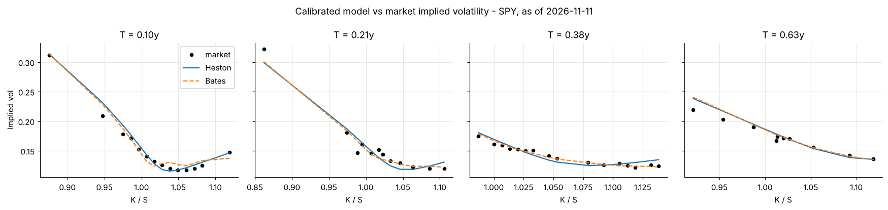
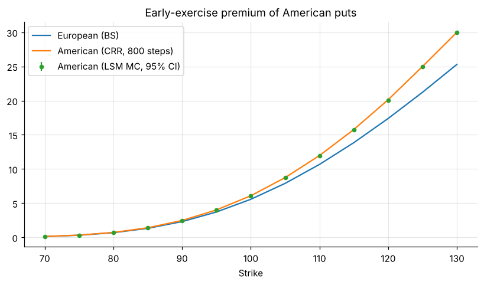
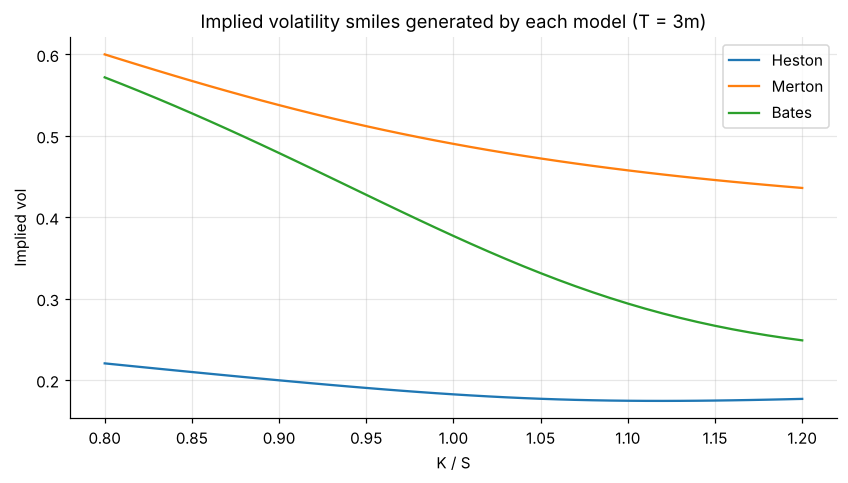
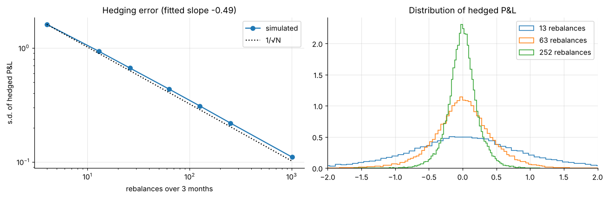
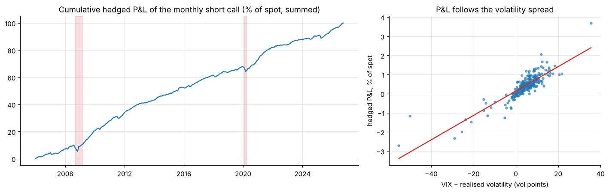

# Derivatives Pricing Toolkit

A tested Python library and set of notebooks for pricing and calibrating equity options and interest-rate models: **Black-Scholes, binomial trees, Monte Carlo (incl. Longstaff-Schwartz), Heston, Merton jump-diffusion, Bates, Vasicek and CIR**, plus a delta-hedging simulator.



## What's inside

| Area | Methods |
|---|---|
| **Black-Scholes** | Closed-form prices, analytic Greeks (Δ, Γ, vega, Θ, ρ), implied volatility, put-call parity |
| **Lattice** | Cox-Ross-Rubinstein binomial tree for European and American exercise |
| **Monte Carlo** | GBM with antithetic variates, Asian, barrier (knock-in/out), Longstaff-Schwartz American, standard errors and 95% CIs |
| **Stochastic volatility** | Heston: semi-analytic Fourier pricing ("little trap" CF) and full-truncation Monte Carlo |
| **Jumps** | Merton: closed-form series, Fourier and exact simulation · Bates: Heston + jumps |
| **Calibration** | Vega-weighted, multi-start least squares to a real SPY option surface |
| **Rates** | Vasicek and CIR zero-coupon bonds, yield-curve calibration, CIR path simulation |
| **Hedging** | Discrete delta-hedging P&L under GBM with volatility mismatch and proportional costs, Leland (1985) adjustment |

All Fourier pricing goes through one Lewis (2001) engine. A model only needs to supply its characteristic function.

## Notebooks

| # | Notebook | Highlights |
|---|---|---|
| 1 | [Black-Scholes & Greeks](notebooks/01_black_scholes_and_greeks.ipynb) | Greeks across strikes, implied-volatility skew from SPY quotes |
| 2 | [Trees, Monte Carlo & exotics](notebooks/02_trees_monte_carlo_exotics.ipynb) | CRR convergence, American early-exercise premium, Asian and barrier options |
| 3 | [Heston, Merton & Bates](notebooks/03_heston_merton_bates.ipynb) | Fourier vs Monte Carlo cross-checks, model-generated smiles, barriers under stochastic vol |
| 4 | [Model calibration](notebooks/04_model_calibration.ipynb) | Parameter-recovery test, SPY surface fit (< 1 vol-point error), CIR/Vasicek yield-curve fit |
| 5 | [Delta hedging in practice](notebooks/05_delta_hedging.ipynb) | Hedging error ∝ 1/√N (fitted slope -0.49), cost-optimal rebalancing, and 250 months of daily-hedged SPY calls priced at the VIX: profitable in 82% of months, P&L correlation 0.87 with implied − realised vol |

<p float="left">
  
  
  
  
</p>

## Quick start

```bash
git clone https://github.com/drimranbhatti/derivatives-pricing-toolkit.git
cd derivatives-pricing-toolkit
pip install -e ".[notebooks,dev]"
pytest                      # 16 tests
jupyter lab notebooks/
```

```python
from derivpricer import black_scholes as bs, heston

bs.price(S=100, K=100, T=1, r=0.05, sigma=0.2)                 # 10.4506
bs.greeks(100, 100, 1, 0.05, 0.2).delta                         # 0.6368

p = heston.HestonParams(v0=0.04, kappa=2.0, theta=0.04, xi=0.5, rho=-0.7)
heston.price(100, [90, 100, 110], 1.0, 0.05, p)                 # vectorised over strikes
```

## Validation

The test suite checks every model against an independent result:

* Black-Scholes against textbook values (Hull); analytic Greeks against finite differences
* CRR tree converges to Black-Scholes; an American call equals the European call when there are no dividends
* Longstaff-Schwartz matches the 1,000-step tree for American puts
* Heston collapses to Black-Scholes when vol-of-vol → 0; Fourier price is inside the Monte Carlo confidence interval
* Merton Fourier price equals Merton's closed-form series to 1e-4
* Bates with zero jump intensity equals Heston
* Calibration recovers known Heston parameters from a synthetic surface
* Delta-hedging error shrinks like 1/√N, and the hedge is fair on average

## Project layout

```
src/derivpricer/   black_scholes · trees · monte_carlo · heston · merton · bates · calibration · rates · hedging
notebooks/         five executed walkthroughs (outputs included)
data/              dated SPY option and US Treasury snapshots, SPY/VIX/T-bill daily history
scripts/           fetch_market_data.py - refresh the snapshots from Yahoo Finance
tests/             pytest suite
```

## References
Black & Scholes (1973) · Cox, Ross & Rubinstein (1979) · Heston (1993) · Merton (1976) · Bates (1996) · Longstaff & Schwartz (2001) · Lewis (2001) · Albrecher et al. (2007) · Cox, Ingersoll & Ross (1985) · Vasicek (1977) · Leland (1985) · Derman & Kamal (1999)

---
**Author:** Dr. Muhammad Imran Bhatti, PhD (Finance), MScFE · FCMA · [LinkedIn](https://www.linkedin.com/in/drimranbhatti) · [imranbhatti.com](https://imranbhatti.com)

*Built on my MScFE coursework (WorldQuant University) and rewritten as a standalone, tested library. MIT licensed.*
